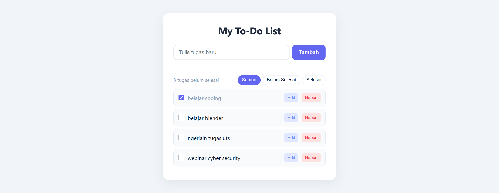
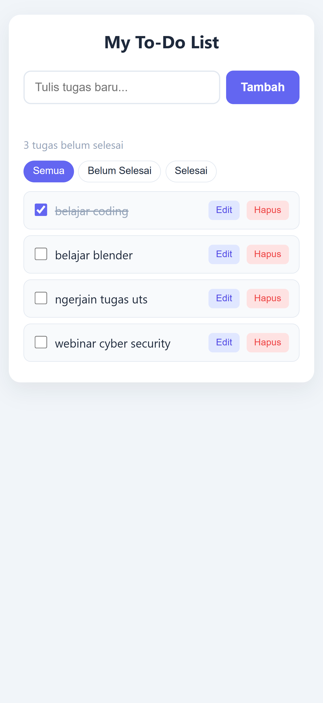

# My To-Do List

Aplikasi To-Do List sederhana yang dibuat dengan HTML, CSS, dan JavaScript murni (tanpa framework). Proyek ini dibuat untuk belajar pemrograman web dan sebagai bagian dari portofolio GitHub.

🔗 **Demo:** https://github.com/HafidzFathkurr/todo-list-web

## Screenshot

**Tampilan laptop**



**Tampilan smartphone**



## Fitur

- Menambahkan tugas baru (tombol **Tambah** atau tekan Enter)
- Menampilkan daftar tugas
- Menandai tugas sebagai selesai (teks dicoret)
- Mengedit tugas yang sudah dibuat
- Menghapus tugas
- Menampilkan jumlah tugas yang belum selesai
- Filter tugas: **Semua**, **Belum Selesai**, dan **Selesai**
- Data tersimpan otomatis dengan LocalStorage, jadi tidak hilang saat halaman di-refresh
- Pesan khusus jika daftar tugas masih kosong
- Validasi: tugas kosong tidak dapat ditambahkan, dan panjang tugas dibatasi 100 karakter
- Tampilan responsif untuk laptop dan smartphone

## Teknologi

| Teknologi            | Kegunaan                                             |
| -------------------- | ---------------------------------------------------- |
| HTML5                | Struktur halaman                                     |
| CSS3                 | Desain, tata letak (Flexbox), dan tampilan responsif |
| JavaScript (Vanilla) | Logika aplikasi dan manipulasi DOM                   |
| LocalStorage         | Penyimpanan data di browser                          |

Tidak menggunakan framework atau library tambahan.

## Struktur Folder

```
todo-list-web/
├── index.html      # Struktur halaman
├── style.css       # Desain dan tampilan
├── script.js       # Logika aplikasi
├── README.md       # Dokumentasi proyek
└── screenshots/    # Gambar untuk README
```

## Cara Menjalankan

**Cara 1: Langsung di browser**

1. Unduh atau clone repository ini.
2. Buka file `index.html` dengan browser (klik dua kali).

**Cara 2: Menggunakan Live Server di VS Code**

1. Clone repository:
   ```bash
   git clone https://github.com/HafidzFathkurr/todo-list-web.git
   ```
2. Buka foldernya di Visual Studio Code.
3. Pasang ekstensi **Live Server** (Ritwick Dey).
4. Klik kanan `index.html`, lalu pilih **Open with Live Server**.

## Cara Menggunakan

1. Ketik tugas pada kolom input, lalu klik **Tambah**.
2. Centang kotak di sebelah kiri untuk menandai tugas selesai.
3. Klik **Edit** untuk mengubah teks tugas.
4. Klik **Hapus** untuk menghapus tugas.
5. Gunakan tombol **Semua**, **Belum Selesai**, dan **Selesai** untuk menyaring daftar.

## Yang Dipelajari

- Membuat dan memanipulasi elemen HTML dengan JavaScript (DOM)
- Menangani event (klik, keyboard, perubahan checkbox)
- Mengelola data dengan array dan objek
- Menyimpan dan membaca data dengan LocalStorage dan JSON
- Membuat desain responsif dengan CSS Flexbox dan media query
- Menggunakan Git dan GitHub dengan commit bertahap

## Rencana Pengembangan

- [ ] Mode gelap (dark mode)
- [ ] Edit langsung di dalam daftar tanpa kotak dialog
- [ ] Tanggal tenggat untuk setiap tugas
- [ ] Tombol "Hapus semua tugas selesai"

## Pembuat

**Hafidz Fathkurrohman**  
GitHub: [@HafidzFathkurr](https://github.com/HafidzFathkurr)
